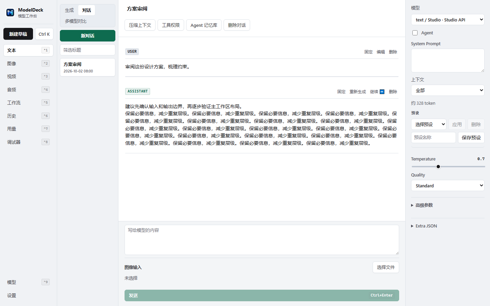
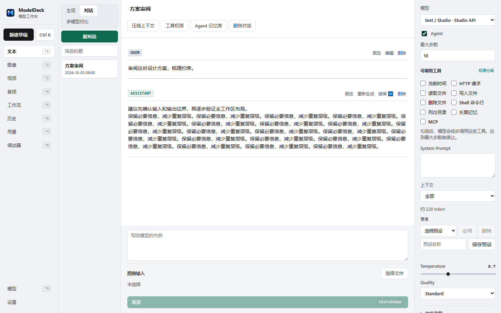
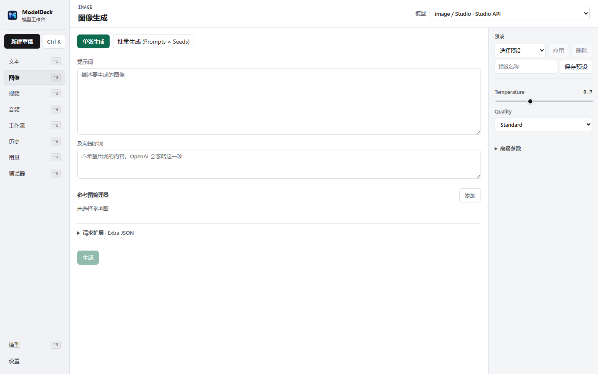
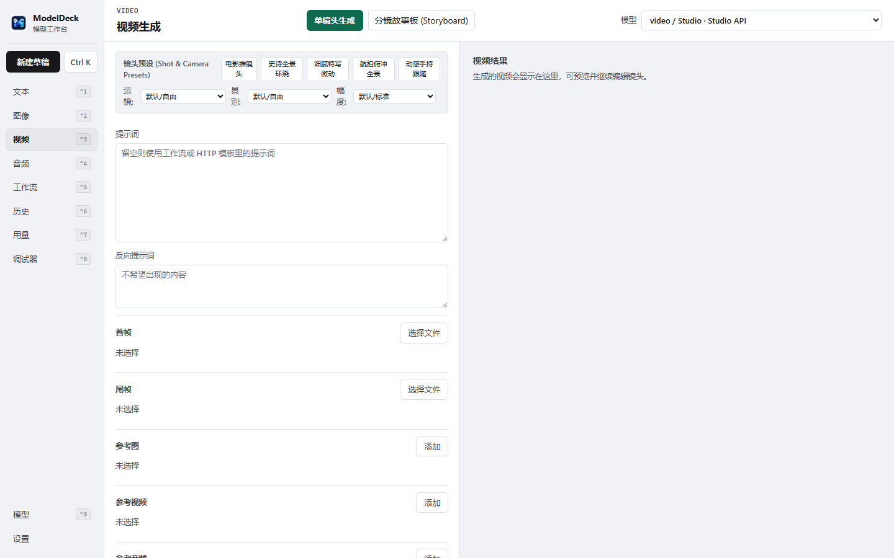
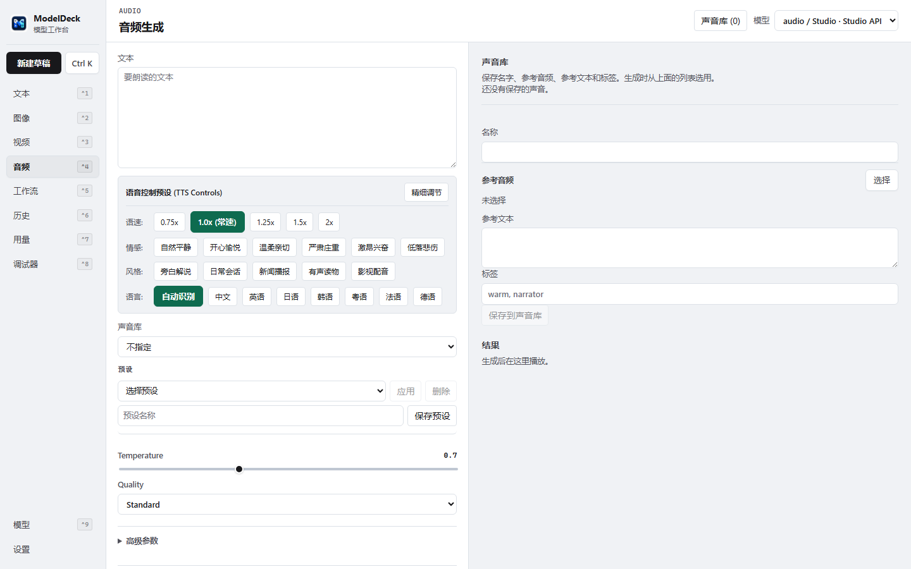
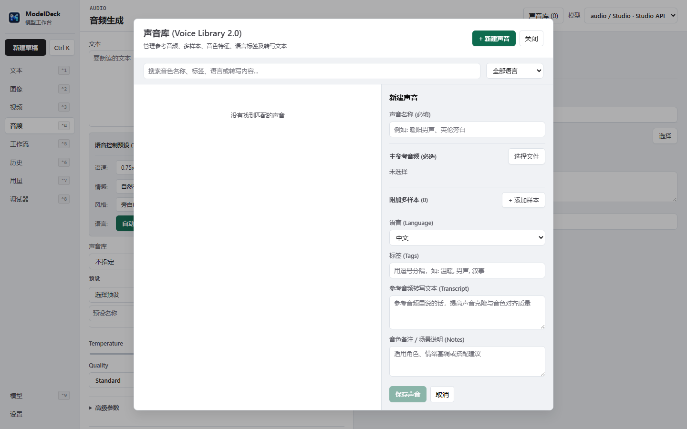
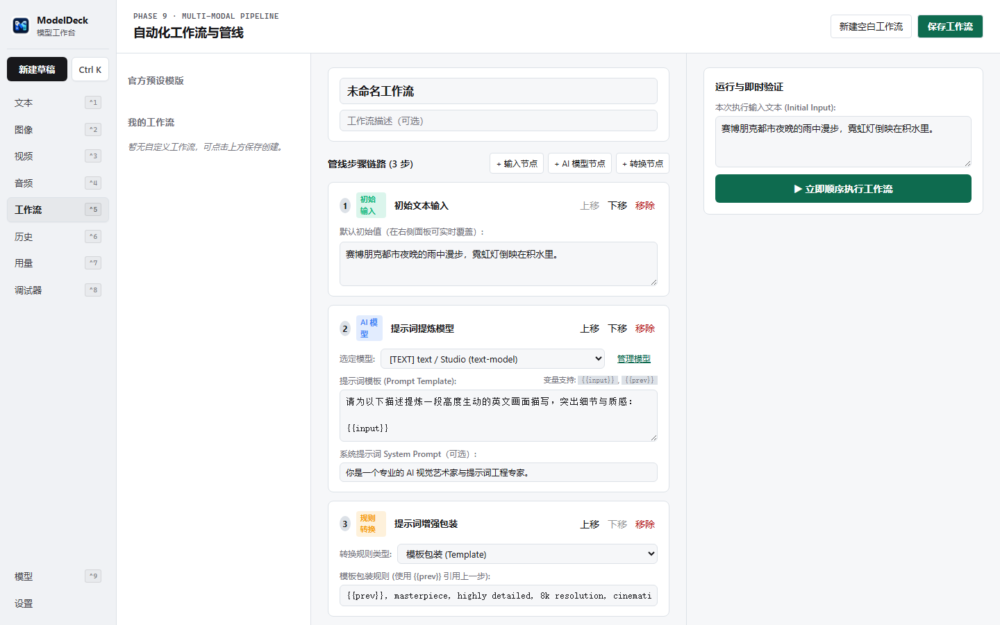
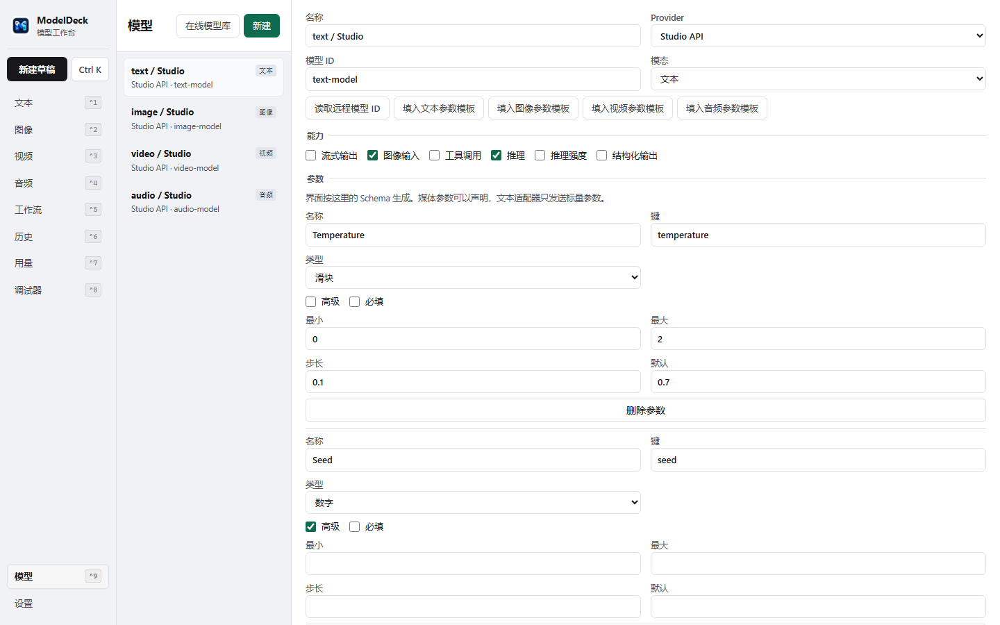
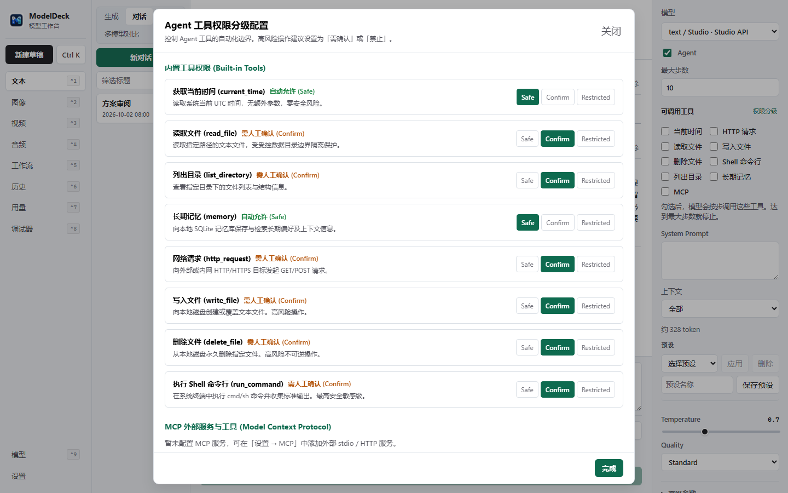

# ModelDeck 🎛️

<p align="center">
  <strong>Windows 本地优先的高性能轻量级多模态 AI 模型工作台</strong><br>
  <em>A Lightweight, Local-First Multimodal AI Workbench for Windows</em>
</p>

<p align="center">
  <a href="LICENSE"></a>
  <a href="https://github.com/rowanjove/modeldeck/releases"></a>
  
  
  
  
</p>

---

## 📖 关于 ModelDeck

**ModelDeck** 是一款专为 Windows 平台打造的**本地优先（Local-First）**轻量级多模态 AI 工作台。

在当下大模型快速演进的生态中，开发者和创作者往往面临着 API 散乱、不同模态工具割裂、云端隐私泄露担忧以及各类客户端臃肿的问题。**ModelDeck 的核心定位是“模型配置器 + API 客户端 + 多模态工作台 + Agent 会话工具”**。

> **轻量承诺**：ModelDeck 本身**不捆绑任何数十 GB 的大模型权重，不内置臃肿的 Python 运行时**。所有计算通过标准协议连接云端主流 API（OpenAI, Claude, Gemini, DeepSeek 等）或本地推理服务（Ollama, LM Studio, ComfyUI, vLLM）。轻量、极速启动、内存占用低。

---

## ✨ 核心特性

### 💬 1. 智能对话与全能会话 (Chat & Completion)
- **多模型同屏与切换**：支持 OpenAI、Claude、Gemini、DeepSeek 及任意 OpenAI 兼容端点自由切换与多模型对比。
- **长文本上下文管理**：内置 CJK 智能 Token 估算、滑窗修剪、历史摘要压缩与关键消息 **Pin（置顶锁定）** 保护。
- **富文本与代码高亮**：完整支持 Markdown、数学公式、代码高亮渲染与一键复制。

### 🎨 2. 多模态创作矩阵 (Multimodal Studio)
- **图像生成与编辑**：支持文生图、图生图、Inpainting 局部重绘、遮罩涂抹与高清放大。
- **视频生成与运动控制**：支持文生视频、图生视频、首尾帧控制与多镜头生成。
- **语音合成与克隆 (TTS & Voice Clone)**：内置音色库管理，支持参考音频上传、声音克隆与双语字幕生成。

### 🔌 3. ComfyUI 原生深度集成
- **工作流无缝桥接**：直接读取与绑定 ComfyUI JSON 工作流，自动解析输入节点与参数控件。
- **显存保护与队列控制**：独占单并发调度器，防止多任务并发导致 GPU 显存（OOM）崩溃。
- **执行状态追踪**：基于 WebSocket 实时获取节点执行进度与中间预览图生成。

### 🤖 4. Agent 智能体与 MCP (Model Context Protocol) 生态
- **持久化 MCP 进程池**：内置单例管理引擎，支持 Stdio 与 HTTP MCP 工具服务的握手与跨轮复用，无缝连接文件系统、GitHub、搜索等扩展能力。
- **安全沙箱与权限拦截**：工具调用具备细粒度权限管控弹窗确认，绝不允许未授权的外部执行。

### 🔄 5. 工业级后台持久任务系统 (Persistent Job Queue)
- **UI 与生成解耦**：所有图像、视频、音频渲染任务由 Rust 后台持久化队列托管，切换页面、挂起后台不影响任务进度。
- **崩溃自愈与断电保护**：基于 CAS 状态机，应用异常退出或重启后自动检测并安全标记 `interrupted`，绝不静默丢失任务。
- **取消直通控制**：从前端 UI 到后端 HTTP / WebSocket 链接层具备贯穿式取消信号，立即中断远端轮询与网络开销。

### 🛡️ 6. 严苛的数据安全与隐私保护 (Security by Design)
- **Windows 原生凭据保护**：API Key 存储接入 **Windows Credential Manager (DPAPI)** 原生安全加密后端。
- **全链路敏感数据脱敏**：网络调试日志、控制台输出、诊断包导出严格过滤脱敏 Bearer Token 与嵌入式 Key。
- **本地存储与 SQLite 事务**：会话、任务与资产元数据存储于本地 SQLite，采用 WAL 模式与原子事务写入，支持断电与磁盘故障保护。
- **SQLite FTS5 中文全文检索**：内置 CJK 智能切分与 FTS5 虚拟表，毫秒级检索海量历史会话与素材资产。

---

## 🖼️ 界面预览 (Screenshots)

### 💬 智能对话 (Chat)
> 现代化多轮对话界面，支持流式高响应、上下文锁定与多模型一键切换。


### 🤖 Agent 智能体与工具调用 (Agent & MCP)
> 智能体自主推理，联动持久化 MCP 进程池执行复杂本地与云端工具链。


### 🎨 多模态生图工作台 (Image Studio)
> 精准控制采样器、步数、尺寸与图生图参数，实时预览与一键收藏。


### 🎬 视频生成与动效控制 (Video Studio)
> 支持多 Provider 视频模型，支持首尾帧参考、提示词优化与进度回传。


### 🎙️ 语音合成与声音克隆 (Audio & Voices)
> 丰富的音色管理中心，支持导入参考音频克隆音色与文本转语音。



### 🔀 自动化工作流 (Workflow Pipeline)
> 多节点流程编排与 ComfyUI 模板绑定，一键执行复杂串联生成任务。


### ⚙️ 模型配置与安全权限 (Models & Permissions)
> 统一管理云端 API 与本地端点，配合细粒度的 Agent 工具调用沙箱安全拦截。



---

## 📥 下载与使用 (Download)

前往 [GitHub Releases](https://github.com/rowanjove/modeldeck/releases) 下载最新发行版：

| 分发版本 | 文件格式 | 适用场景 |
| :--- | :--- | :--- |
| **便携免安装版 (Portable)** | `.exe` / `.zip` | 解压即用，配置保存在本地目录，随身携带（推荐） |
| **中文安装包 (Setup zh-CN)** | `.msi` | Windows 原生安装向导，简体中文界面 |
| **英文安装包 (Setup en-US)** | `.msi` | Windows 原生安装向导，英文界面 |
| **NSIS 标准安装包** | `.exe` | 现代化桌面安装程序，自动创建开始菜单与桌面快捷方式 |

> **运行环境要求**：
> - 操作系统：Windows 10 / Windows 11 (64-bit)
> - 依赖项：Microsoft Edge WebView2 Runtime（Windows 10/11 系统通常已预装）

---

## 🚀 开发者快速上手 (Developer Guide)

### 环境依赖
- [Node.js](https://nodejs.org/) (>= 18.0)
- [Rust](https://www.rust-lang.org/) (>= 1.80) 与 `cargo`
- Visual Studio C++ 生成工具 (Windows C++ Build Tools)

### 本地启动

```bash
# 1. 克隆仓库
git clone https://github.com/rowanjove/modeldeck.git
cd modeldeck

# 2. 安装前端依赖
npm install

# 3. 启动开发模式 (Vite + Tauri)
npm run tauri dev
```

### 验证与测试套件

ModelDeck 包含严格的前后端自动化测试与代码质量规范：

```bash
# 运行前端类型检查与 Lint 扫描
npm run typecheck
npm run lint

# 运行前端 22 项自动化单元测试
npm run test

# 运行 Rust 核心后端检查与 118 项集成/单元测试
cargo check --manifest-path src-tauri/Cargo.toml
cargo test --manifest-path src-tauri/Cargo.toml
```

### 生产打包构建

```bash
# 编译前端并构建 Tauri Windows 安装包
npm run tauri build
```

---

## 🌐 支持的接入服务与 Provider

ModelDeck 支持自由接入任意符合规范的服务端点：

- **云端大模型 API**：
  - OpenAI (GPT-4o, o1, o3-mini)
  - Anthropic (Claude 3.5 Sonnet, Claude 3.7)
  - Google Gemini (Gemini 2.5 Pro, Flash)
  - DeepSeek (V3, R1)
  - SiliconFlow (硅基流动), OpenRouter, Replicate, Fal.ai
- **本地模型服务**：
  - Ollama
  - LM Studio
  - vLLM / llama.cpp
  - ComfyUI (Local SD / Flux / Animatediff)
  - 任意 OpenAI 兼容 HTTP 服务
- **工具协议生态**：
  - Anthropic Model Context Protocol (MCP) Stdio / SSE / HTTP

---

## 🤝 参与贡献 (Contributing)

欢迎任何形式的贡献！如果你有好的想法、发现了 Bug 或希望增加对新模型/工具协议的支持：

1. Fork 本仓库并新建分支 (`git checkout -b feat/your-feature`)
2. 提交你的改动 (`git commit -m 'feat: add support for xyz'`)
3. 确保所有自动化测试绿灯通过 (`npm run test && cargo test`)
4. 开启一个 Pull Request

---

## 📄 开源协议 (License)

本项目采用 [Apache License 2.0](LICENSE) 开源协议。
