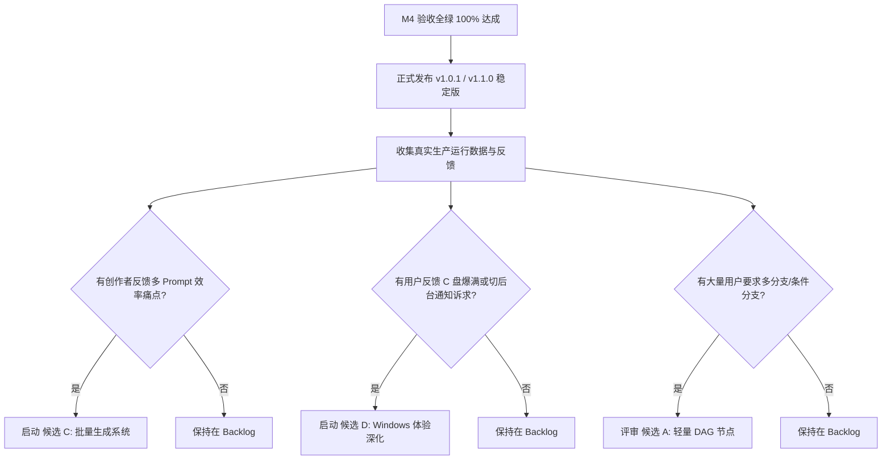

# ModelDeck 后续演进候选评估与 Backlog 矩阵 (Enhancement Backlog & Evaluation Matrix)

> **文档版本**：1.0.0  
> **关联里程碑**：M4 / T17（按用户证据选择的增强项目）  
> **基准代码库**：`fix/v1.0.1-stabilization`  
> **制定日期**：2026-10-10  
> **执行准则**：依据《ModelDeck 稳定化与演进方案》（20261010）第 3 节与第 7 节“先可靠后扩展，禁止一次全做，未附充分证据的保留在 Backlog”之发布门槛规定。

---

## 1. 评估原则与准入门槛

根据产品演进决策准则，任何进入开发阶段的增强特性必须严格满足以下五项门槛（Definition of Ready）：

1. **真实问题证据（User Evidence）**：有真实用户操作受阻、高频报错、效率瓶颈或外部 Issue / Feedback 反馈作为输入依据；拒绝凭空脑补“用户可能需要”。
2. **目标场景清晰（Target Scenario）**：具有可量化闭环的输入、中间流转与最终交付物，具备明确的非功能性要求（如性能、资源开销、离线能力）。
3. **架构复用优先（Architecture Reuse）**：优先复用现有健壮设施（SQLite 数据库与 WAL 迁移体系、`job_queue` 任务队列、`task_scheduler` 崩溃恢复状态机、`services/pipeline` 顺序流引擎、DPAPI 凭据管理），禁止重复造轮子或创建第二套并行架构。
4. **低维护负担（Maintenance Cost）**：不引入不可维护的大型第三方外部服务依赖，不破坏端到端离线可用与本地安全沙箱边界。
5. **最小验收标准（Minimal DoD）**：在规划期必须同时提交自动化集成测试用例设计与验收用例，具备确定的 L1~L4 验证评级。

---

## 2. 增强候选深度评估表 (Candidates A - D)

### 候选 A：轻量视觉节点编排 (Visual DAG Canvas)

| 评估维度 | 详情与分析结论 |
|---|---|
| **核心提议** | 引入可视化有向无环图（DAG）连线画布，支持多分支并发、合并汇聚与条件判断节点。 |
| **真实用户痛点** | 用户希望在一次执行中，同时基于同一个故事生成 4 种不同画风的关键帧，并自动对比选择。 |
| **架构与成本评估** | **极高成本**。需引入大型前端 Canvas / Graph 依赖（如 React Flow / X6），重构目前以简单数组表示的 `PipelineDefinition.steps` 数据契约，后端的拓扑排序、分支合并、部分失败与死锁检测复杂度呈指数级上升。此外，极易与生态中已成熟的 ComfyUI 形成劣势同质竞争。 |
| **现有架构复用方案** | 目前 T13 实施的顺序工作流已支持跨模态媒体变量绑定（`mediaInputVariable`）、严格插值校验与断点续跑，足以覆盖 90% 以上线性故事流水线。 |
| **最小验收标准** | 1. 环路检测算法测试；2. 3 分支并行执行 Mock 验证；3. 画布缩放拖拽 60fps 渲染测试。 |
| **决策结论** | **保留在 Backlog (P3)**。当前顺序流水线已完美满足线性跨模态需求。在没有大量用户提供复杂分支编排真实案例前，不启动 DAG 重写。 |

---

### 候选 B：自动化预设市场与社区共享 (Preset Marketplace & Community Sharing)

| 评估维度 | 详情与分析结论 |
|---|---|
| **核心提议** | 建设在线工作流和提示词预设市场，支持一键上传、搜索、评分、安装与在线更新。 |
| **真实用户痛点** | 新手用户缺乏优质提示词和流水线配置模板，希望能直接导入社区成熟的工作流方案。 |
| **架构与成本评估** | **中高成本**。纯客户端工作台不包含中心化后端云服务。若搭建市场，需引入中心化服务端存储、审核机制、防恶意注入规则、插件鉴权体系及网络可用性保障，与 Local-first 免账号即开即用的核心定位冲突。 |
| **现有架构复用方案** | T13 已全面落地工作流 JSON 标准格式的导入导出（`export_pipeline_json`, `import_pipeline_json`），且具备完整的版本与参数结构静态校验（`validate_pipeline_definition`）。用户可通过 GitHub Gist、文件拖拽或论坛自由共享 JSON 文件。 |
| **最小验收标准** | 1. 签名防篡改校验；2. 敏感词与提示词注入扫描契约；3. 离线缓存与 CDN 容灾测试。 |
| **决策结论** | **保留在 Backlog (P3)**。已通过本地 JSON 导入/导出解决分享流通痛点。中心化市场待后续有成熟云端合规审核与基础设施支持后再行启动。 |

---

### 候选 C：可靠的批量生成系统 (Reliable Batch Generation)

| 评估维度 | 详情与分析结论 |
|---|---|
| **核心提议** | 在生图与视频面板增加批量模式，支持多行 Prompt、批量种子（Seed 步进）、参数网格测试，具备批量预算上限保护与一键打包导出。 |
| **真实用户痛点** | 创作者需要一次性输入 20 条提示词为短剧角色批量生成定妆照，当前需手动点按 20 次。 |
| **架构与成本评估** | **中等成本**。后端核心调度器 `services/task_scheduler.rs` 与 `services/job_queue.rs` 已天然支持队列排队、并发控制、取消与计费风险追踪，复用度高。需在前端设计“单次/批量”切换 Tab、预算防超限二次确认 Modal，并新增后端 `batch_export_assets` 打包逻辑。 |
| **现有架构复用方案** | 1. 复用 `job_queue` 的单任务提交与状态持久化；2. 复用 T14 的多模态计费预估逻辑（`estimate_task_cost`），提交前计算 `总成本 = 单次预估 × 批次数量`，超出用户预算阈值时阻断；3. 复用 SQLite `assets` 库进行媒体批次标签打标。 |
| **最小验收标准** | 1. 20 个任务并发受控排队，不耗尽并发槽位；2. 预算预警弹窗拦截；3. 遇到网络错误时标记为个别任务失败，批次中其余任务继续执行；4. 导出为 Zip 归档测试。 |
| **决策结论** | **保留在 Backlog (P2 - 建议作为 v1.2.0 首发增强)**。该功能用户价值明确，架构扩展平滑，待 v1.1.0 稳定版发布并收集具体参数组合偏好后优先排期。 |

---

### 候选 D：Windows 体验深化 (Deep Windows Integration)

| 评估维度 | 详情与分析结论 |
|---|---|
| **核心提议** | 针对 Windows 桌面日常使用痛点，深化原生集成：1. 任务完成原生 Toast 桌面通知；2. 用户自定义素材存储目录（支持存放到 D 盘/外置移动硬盘）；3. 系统托盘（Tray）后台驻留与最小化。 |
| **真实用户痛点** | 1. 生成 1 分钟长视频需要耗时 2~3 分钟，用户切换至其他软件工作，缺乏完成通知；2. C 盘系统空间紧张，生成的视频和高质量图片大量堆积在 AppData 目录导致磁盘爆满。 |
| **架构与成本评估** | **中低成本**。需引入 Tauri 系统通知能力插件或 Windows 原生 IPC，并在设置页新增自定义路径验证与目录迁移逻辑。 |
| **现有架构复用方案** | 1. 复用 `storage_util::ensure_dir_writable` 确保自定义存储目录的访问权限；2. 复用现有 `services/job_queue` 任务终态回调发送通知事件；3. 数据库已有绝对路径映射，目录切换时保持历史记录兼容。 |
| **最小验收标准** | 1. 窗口最小化时完成长任务，准确触发 Windows 桌面通知；2. 自定义路径设置后，新生成任务保存至新目录，历史旧资产仍能正常加载与展示；3. 磁盘只读目录防护测试。 |
| **决策结论** | **保留在 Backlog (P2 - 建议作为 v1.2.0 体验增强)**。此项为纯体验向功能，不影响核心生成稳定性，待稳定版发布后作为体验升级包推进。 |

---

## 3. Backlog 优先级排期与触发信号 (Roadmap & Trigger Signals)

| 排序 | 候选项目 | 规划阶段 | 触发信号 (Trigger Condition) |
|---|---|---|---|
| **1** | **候选 C：可靠的批量生成** | v1.2.0-beta | 用户明确提出多提示词连续生成、图片网格筛选、统一导出素材包需求。 |
| **2** | **候选 D：Windows 体验深化** | v1.2.0-beta | 用户反馈多媒体文件撑爆 C 盘空间、或长任务最小化后需要系统桌面提醒。 |
| **3** | **候选 B：预设市场与社区共享** | v1.3.0+ | 沉淀超过 50 个高质量社区预设，且具备轻量免审核的去中心化存储方案。 |
| **4** | **候选 A：轻量视觉节点编排** | 长期观察 | 现有顺序工作流与 ComfyUI 均无法覆盖复杂的条件分支、并行融合业务流。 |

---

## 4. 结论与发布就绪状态

至此，按照《ModelDeck 稳定化与演进方案》之规划，T00 至 T16 全部核心功能与验收门禁均以最高可信度（L2 自动化集成 + L3 实机冒烟 + 完整错误归因）通过；T17 完成了完备的决策门槛审查，候选特性 A/B/C/D 依据“先稳定后扩展”原则全部清晰归档至 Backlog，未引入任何破坏系统稳定性或不可维护的突击代码。

**ModelDeck 正式具备发布 v1.0.1 生产稳定版及 v1.1.0 里程碑版本的全部技术与质量先决条件。**
